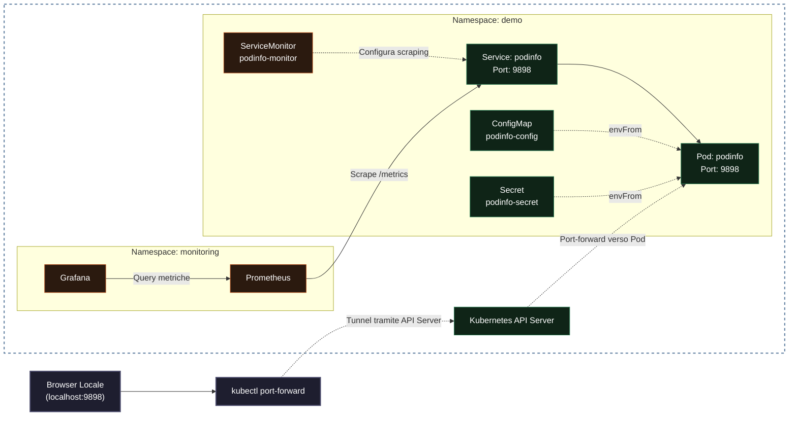
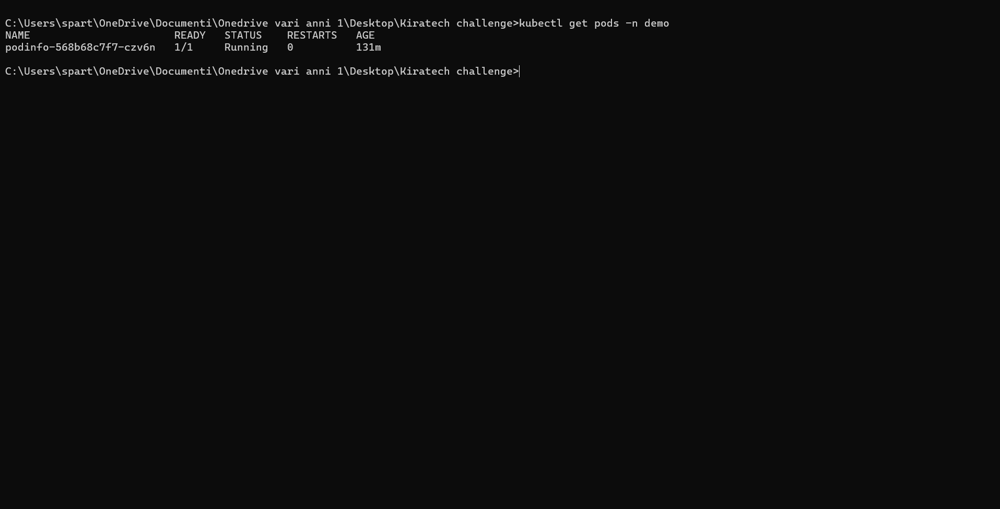
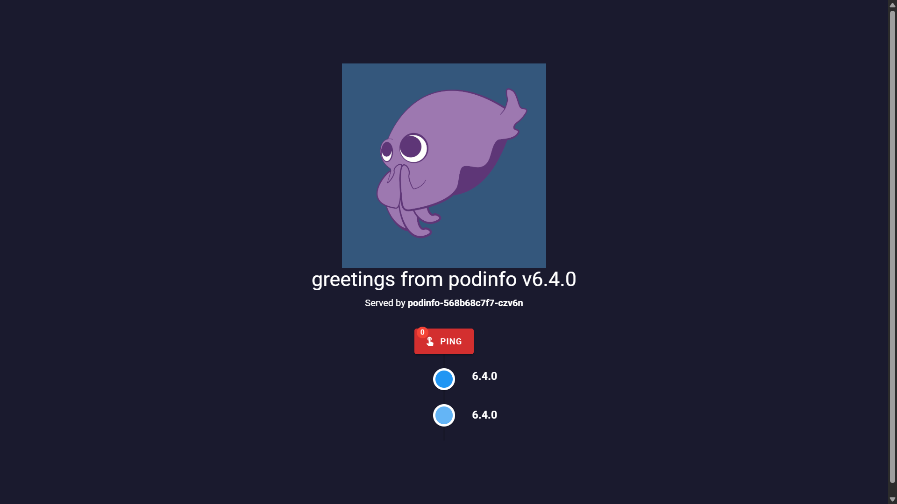
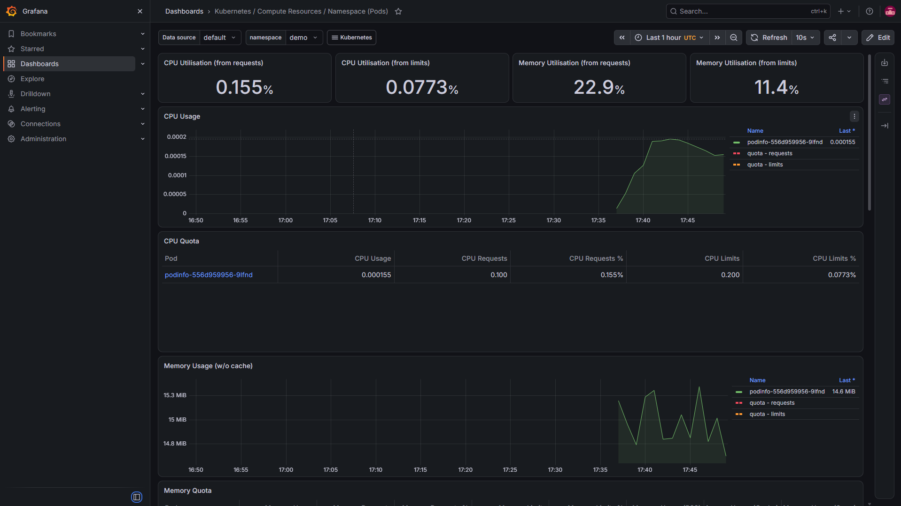

# Challenge L2 Cloud Native - Podinfo

Questo repository contiene la soluzione da me sviluppata per la challenge tecnica per il ruolo di Apprendista L2 Cloud Native Support Engineer.

## Introduzione e contesto

Durante il colloquio conoscitivo ho avuto modo di illustrare il mio percorso e le mie basi tecniche, maturate in ambito scolastico e attraverso un laboratorio personale. In quel contesto avevo configurato un cluster Kubernetes locale (Kind), containerizzato un'applicazione Python, e integrato Prometheus e Grafana. La parte più formativa era stata la simulazione di guasti controllati (CrashLoopBackOff, errori di rete, readiness probe fallite), per i quali raccoglievo evidenze, formulavo ipotesi e documentavo le risoluzioni in incident report su Git.

Quando ho ricevuto questa challenge, ho deciso di applicare quel metodo a un'applicazione open source già strutturata (Podinfo). L'obiettivo non era solo completare i requisiti, ma dimostrare un approccio operativo orientato all'osservabilità e al troubleshooting di secondo livello.

## 1. Applicazione Scelta e Motivazione

**Applicazione:** [Podinfo](https://github.com/stefanprodan/podinfo) (versione 6.4.0)

**Motivazione:** La challenge consigliava Online Boutique, ma ho scelto Podinfo per una scelta strategica. Online Boutique è un'architettura complessa composta da oltre 10 microservizi interconnessi. Per un profilo junior, gestire una rete di dipendenze così articolata avrebbe assorbito la maggior parte del tempo, distogliendomi dall'obiettivo primario della prova: il troubleshooting L2.

Podinfo è una singola applicazione progettata per mostrare le best practice su Kubernetes. Espone nativamente health check (`/healthz`, `/readyz`) e metriche Prometheus (`/metrics`), rendendola il workload ideale per simulare e diagnosticare anomalie. Il PDF (§7.1) permette di scegliere un'applicazione più semplice a patto di motivarla; questa scelta mi ha permesso di concentrarmi sulla profondità tecnica della diagnosi.

## 2. Architettura

Il flusso del deploy segue le best practice di Kubernetes:


*   **Namespace (`demo`):** Isola logicamente le risorse del progetto.
*   **Deployment (`podinfo`):** Gestisce il ciclo di vita del Pod, assicurando che la replica richiesta sia sempre attiva.
*   **Service (`podinfo`):** Espone il Pod all'interno del cluster, permettendo l'accesso locale tramite port-forward.
*   **ConfigMap e Secret:** Separano la configurazione non sensibile dalle credenziali, mantenendo il codice immutabile.

## 3. Struttura del Repository

| File / Cartella | Descrizione |
| :--- | :--- |
| `deploy.sh` | Script Bash per l'automazione del deploy (install, cleanup, destroy). |
| `podinfo.yaml` | Manifest Kubernetes (Namespace, ConfigMap, Deployment, Service). |
| `helm/` | Chart Helm per il deploy parametrizzato dell'applicazione. |
| `monitoring-values.yaml` | Configurazione personalizzata per l'installazione di `kube-prometheus-stack`. |
| `podinfo-monitor.yaml` | ServiceMonitor per abilitare lo scraping delle metriche da parte di Prometheus. |
| `runbook-l2.md` | Procedura operativa standard (SOP) per il troubleshooting con 5 scenari. |
| `.github/workflows/ci.yml` | Pipeline CI per la validazione di manifest, Helm e script Bash. |

## 4. Prerequisiti

Per eseguire questo progetto è necessario avere installato:

* Docker Desktop (con WSL2 attivo su Windows)
* Kind (versione consigliata: v0.22.0 o superiore)
* Kubectl (versione consigliata: v1.29.0 o superiore)
* Helm (versione consigliata: v3.14.0 o superiore)
* Bash (Git Bash su Windows)
* OpenSSL (necessario solo per la generazione manuale del Secret nell'opzione C)


## 5. Installazione e Deploy

Il progetto supporta tre modalità di deploy.

**Opzione A: Deploy tramite Automazione (Consigliato)**

Lo script `deploy.sh` automatizza il deploy tramite manifest Kubernetes: verifica i prerequisiti, crea il cluster Kind se assente, seleziona il contesto corretto, crea il namespace, genera un Secret casuale se non esiste già, applica i manifest e verifica il rollout del Deployment.

```bash
./deploy.sh install
```

**Opzione B: Deploy tramite Helm (Manuale)**

Il Chart Helm gestisce Deployment, Service, ConfigMap e Secret. La chiave viene generata al primo install e mantenuta durante gli upgrade tramite la funzione `lookup`.

```bash
kind create cluster --name kind
helm upgrade --install podinfo-release ./helm \
  --namespace demo-helm \
  --create-namespace \
  --wait
```

**Opzione C: Deploy tramite Manifest YAML (Manuale)**

Il manifest `podinfo.yaml` contiene Namespace, ConfigMap, Deployment e Service. Il Secret viene creato separatamente.

```bash
kind create cluster --name kind
kubectl create namespace demo
kubectl -n demo create secret generic podinfo-secret \
  --from-literal=API_KEY="$(openssl rand -base64 32)"
kubectl apply -f podinfo.yaml
```

**Nota sulle immagini:** viene utilizzata l'immagine ufficiale `stefanprodan/podinfo:6.4.0`. Non è stato necessario creare un Dockerfile personalizzato perché l'immagine upstream soddisfa già i requisiti del laboratorio.

## 6. Verifica e Accesso

Per accedere all'applicazione dal browser:
```bash
kubectl get pods -n demo
kubectl port-forward -n demo svc/podinfo 9898:9898
```
Aprire `http://localhost:9898`. In alternativa, per un test di rete interno al cluster:
```bash
kubectl -n demo run curl-test --rm -i --restart=Never --image=curlimages/curl:8.10.1 -- -fsS http://podinfo:9898/readyz
```




## 7. Osservabilità (Prometheus + Grafana)

Per garantire un livello di osservabilità adeguato, ho installato lo stack `kube-prometheus-stack` tramite Helm nel namespace `monitoring`. Ecco i comandi utilizzati:

```bash
helm repo add prometheus-community https://prometheus-community.github.io/helm-charts
helm repo update
helm install monitoring prometheus-community/kube-prometheus-stack -n monitoring --create-namespace -f monitoring-values.yaml
```

Successivamente, ho applicato il `ServiceMonitor` (file `podinfo-monitor.yaml`) per istruire Prometheus sulla scoperta automatica delle metriche esposte da Podinfo:
```bash
kubectl apply -f podinfo-monitor.yaml
```

Per accedere a Grafana, dato che Helm genera una password casuale al primo avvio, l'ho recuperata decodificando il relativo Secret:
```bash
kubectl get secret monitoring-grafana -n monitoring -o jsonpath="{.data.admin-password}" | base64 --decode
```
Infine, ho eseguito il port-forward verso il servizio di Grafana (`kubectl port-forward -n monitoring svc/monitoring-grafana 3000:80`) e ho verificato il funzionamento monitorando la dashboard `Kubernetes / Compute Resources / Namespace (Pods)`, filtrando per il namespace `demo`.



## 8. Troubleshooting e Incident Management

Il cuore del progetto è rappresentato dal [Runbook L2](./runbook-l2.md).

Ho riprodotto e documentato 5 scenari di errore: `ImagePullBackOff`, `Connection Refused` (errore di rete/Service), `CrashLoopBackOff`, `Readiness Probe Failed` e `OOMKilled`. Per ogni scenario ho incluso i comandi di riproduzione, la raccolta delle evidenze (`kubectl get`, `describe`, `logs`), la diagnosi, la correzione/rollback e i criteri di escalation verso il team di sviluppo.

## 9. Debugging e Problemi Riscontrati

Questa è la sezione che racconta il "dietro le quinte" del progetto, dove ho incontrato e risolto gli ostacoli più complessi:

*   **L'errore YAML (`control characters are not allowed`):** Durante i primi deploy, `kubectl apply` falliva in continuazione. Inizialmente pensavo a un errore di indentazione, ma dopo aver controllato più volte il file ho capito che il problema era dovuto al copia-incolla da Windows, che inseriva caratteri invisibili (come i ritorni a capo CRLF). Ho risolto impostando VS Code su LF, usando solo spazi per l'indentazione e salvando in formato UTF-8.
*   **Il problema della codifica su GitHub (`cp1252`):** Dopo aver caricato i file su GitHub, mi sono accorto che tutte le lettere accentate (è, à, ù) sparivano o diventavano simboli strani. Ho scoperto che Windows salvava di default in `cp1252`. Ho riconvertito i file in UTF-8 e aggiunto `.gitattributes` per mantenere coerenti i fine riga in formato LF durante le operazioni Git.
*   **Il bug del Chart Helm (`#` come commento):** Nel creare il Chart, mi sono accorto che il colore di Podinfo (impostato via ConfigMap) non cambiava. Non capivo il motivo, finché non ho fatto un `helm template` e ho visto che il valore generato era vuoto. Il carattere `#` nel codice esadecimale del colore (`#1a1a2e`) veniva letto da YAML come l'inizio di un commento. Ho risolto aggiungendo il filtro `| quote` nel template, in modo da forzare il valore a essere una stringa racchiusa tra virgolette.

## 10. Uso dell'AI

In linea con le direttive della challenge, ho utilizzato l'AI come supporto al mio processo di apprendimento e documentazione, ma ho sempre mantenuto un approccio critico e di verifica manuale sul mio cluster. Non ho mai copiato e incollato codice senza prima comprenderne il funzionamento.

*   **Analisi e Troubleshooting:** L'AI mi è stata utile per interpretare errori di runtime complessi che non avevo mai affrontato. Ad esempio, durante un test, un Pod è andato in stato `OOMKilled` con `Exit Code 137`. L'AI mi ha spiegato che il codice 137 indica un'uccisione forzata da parte del kernel Linux (SIGKILL) a causa del superamento dei limiti di memoria (Out Of Memory). Questo mi ha permesso di capire che dovevo agire sul limite `resources.limits.memory` nel manifest.
*   **Problem Solving su Helm:** L'AI mi ha aiutato a capire il comportamento del parser YAML con il carattere `#` nel Chart Helm, spiegandomi il concetto di "escape" delle stringhe e suggerendomi l'uso del filtro `| quote`.
*   **Documentazione:** Ho utilizzato l'AI per migliorare la chiarezza e la struttura di questo README e del Runbook, partendo sempre da mie bozze o appunti presi durante le sessioni di test.

Ogni comando suggerito è stato eseguito, compreso e verificato da me sul mio ambiente locale prima di essere incluso in questo repository.

## 11. Valutazione Concettuale di Krateo

Krateo è una piattaforma di Platform Engineering progettata per standardizzare e orchestrare il deployment di risorse su Kubernetes.

Il suo ruolo principale è spostare l'attenzione dalla scrittura manuale di manifest YAML alla creazione di **template riutilizzabili**. In un'ottica enterprise, Krateo permetterebbe di creare una "Custom Resource Definition" (CRD) astratta per Podinfo. L'utente finale (es. un team di sviluppo) non dovrebbe conoscere i dettagli di Kubernetes, ma fornirebbe solo pochi parametri essenziali. Krateo orchestrerebbe automaticamente la creazione di Deployment, Service e Ingress, applicando policy di sicurezza centralizzate.

**Parametri essenziali per un template Krateo:**

| Parametro | Descrizione | Valore di Default |
| :--- | :--- | :--- |
| `appName` | Nome dell'applicazione | `podinfo` |
| `namespace` | Namespace di destinazione | `demo` |
| `imageTag` | Tag dell'immagine Docker | `6.4.0` |
| `uiColor` | Colore dell'interfaccia | `#1a1a2e` |
| `replicaCount` | Numero di repliche | `1` |

**Esempio illustrativo di Custom Resource (CR) per Krateo:**

```yaml
apiVersion: platform.krateo.io/v1alpha1
kind: Podinfo
metadata:
  name: demo-podinfo
spec:
  namespace: demo
  imageTag: "6.4.0"
  uiColor: "#1a1a2e"
  replicas: 1
```
*(Nota: Questo è un esempio illustrativo di come potrebbe apparire la risorsa, non un CRD realmente installato).*

**Benefici:** Riduzione drastica dell'errore umano, deploy più rapidi, standardizzazione delle configurazioni e governance centralizzata.
**Limiti:** Introdurre Krateo in un contesto molto piccolo (come questa challenge) aggiunge un livello di astrazione e complessità che non è giustificato; in questo caso, un Chart Helm tradizionale è la soluzione più proporzionata.

## 12. Limiti della Soluzione e Sicurezza

- **Gestione dei Secret:** Il repository non contiene password in chiaro. Lo script `deploy.sh` genera dinamicamente la chiave `API_KEY` utilizzando 32 byte casuali da `/dev/urandom`, codificati in Base64. Nel percorso Helm, il Secret viene generato dal Chart e mantenuto durante gli upgrade tramite `lookup`. Per un ambiente di produzione si raccomanda l'utilizzo di soluzioni dedicate come Sealed Secrets o HashiCorp Vault. I Secret Kubernetes sono codificati in Base64 e, senza configurazione aggiuntiva, non sono automaticamente cifrati a riposo.-
- **Sicurezza del Pod:** Nel manifest e nel Chart Helm sono configurati `runAsNonRoot: true`, UID 1000, `allowPrivilegeEscalation: false`, `readOnlyRootFilesystem: true` e la rimozione delle capabilities Linux. Queste impostazioni riducono i privilegi del container e limitano la possibilità di modificare il filesystem root.
- **Sicurezza del Cluster:** Non ho implementato NetworkPolicy o RBAC avanzati, in quanto l'obiettivo era focalizzarsi sul supporto L2. In produzione, sarebbero configurazioni necessarie.
- **Infrastruttura:** Kind è un cluster a nodo singolo, quindi non offre tolleranza ai guasti infrastrutturali.

## 13. Demo e Verifica Guidata

Per verificare il corretto funzionamento del progetto, è possibile seguire questa procedura:

1.  **Clonazione e struttura:** Esplorare la struttura del repository e i file principali.
2.  **Preparazione ambiente:** Verificare il cluster Kind in esecuzione (`kubectl get nodes`).
3.  **Installazione:** Eseguire il deploy tramite Chart Helm o script.
4.  **Verifica:** Controllare lo stato di Pod e Service.
5.  **Accesso:** Eseguire il port-forward e aprire l'applicazione sul browser.
6.  **Osservabilità:** Mostrare i log, gli eventi del Pod e la dashboard di Grafana.
7.  **Modifica:** Modificare una variabile d'ambiente (es. il colore) e mostrare il riavvio controllato del Pod.
8.  **Errore simulato:** Riprodurre un errore (es. ImagePullBackOff) e spiegare la diagnosi.
9.  **Rimozione e Reinstallazione:** Eseguire il cleanup e riapplicare i manifest.
10. **Krateo:** Valutazione concettuale.
11. **AI:** Esempio pratico di supporto al troubleshooting.

## 14. Rimozione (Cleanup)

Per rimuovere tutte le risorse e distruggere il cluster:

**Tramite script (Consigliato):**

```bash
./deploy.sh cleanup
./deploy.sh destroy
```

**Manualmente (se non usi lo script):**

```bash
kubectl delete -f podinfo.yaml
kind delete cluster
```
